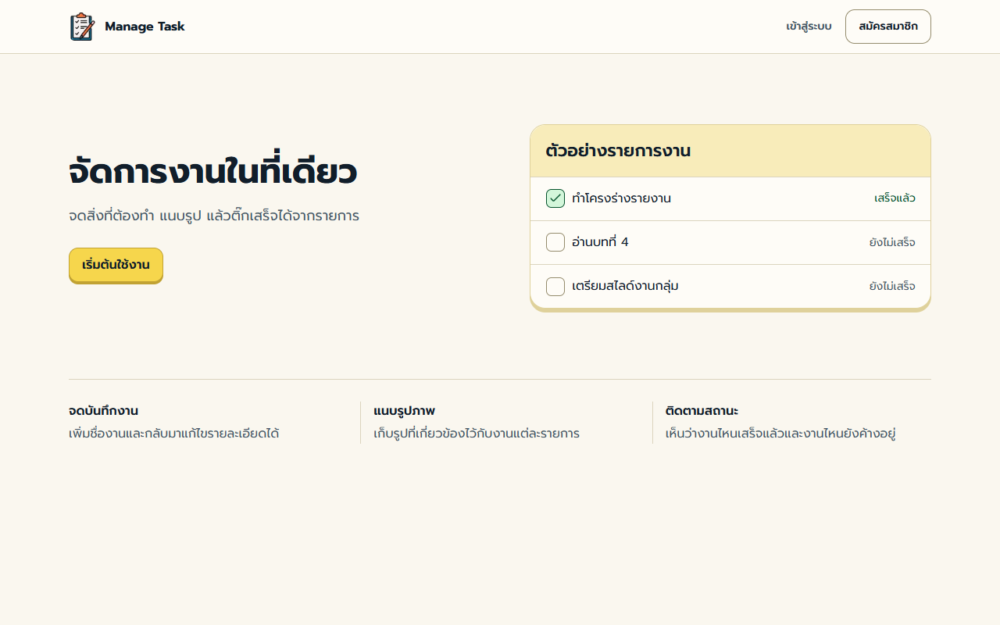
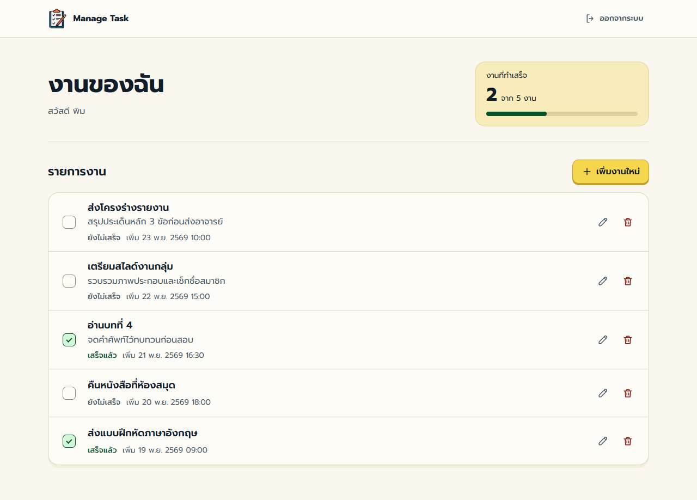
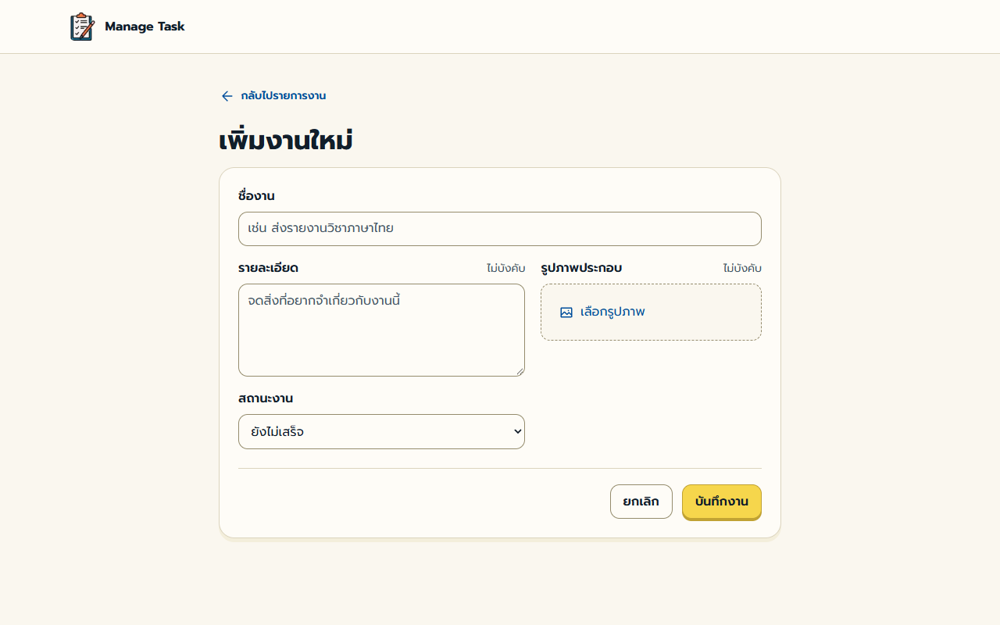
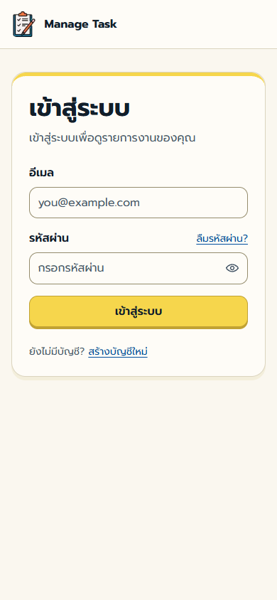
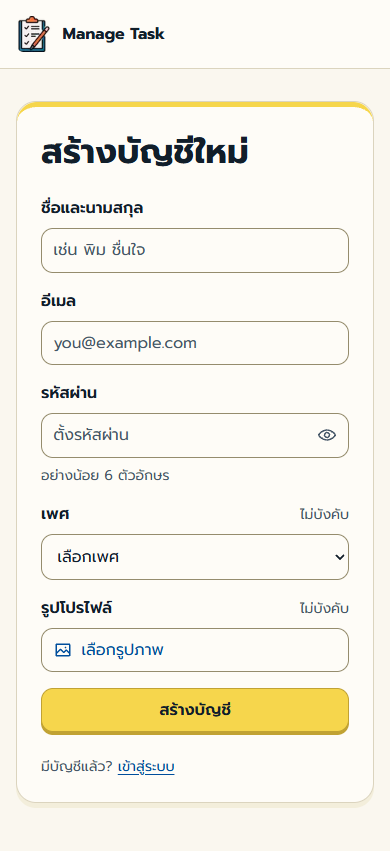
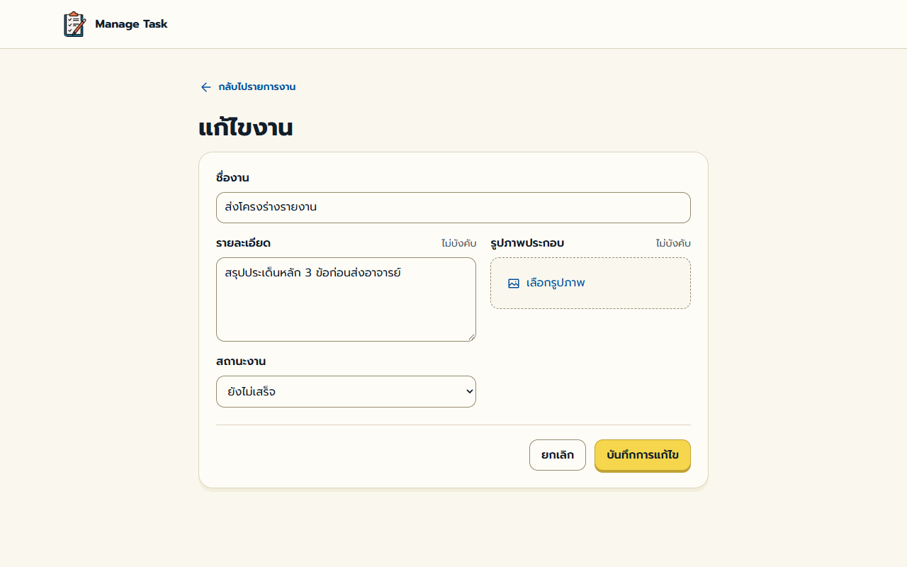
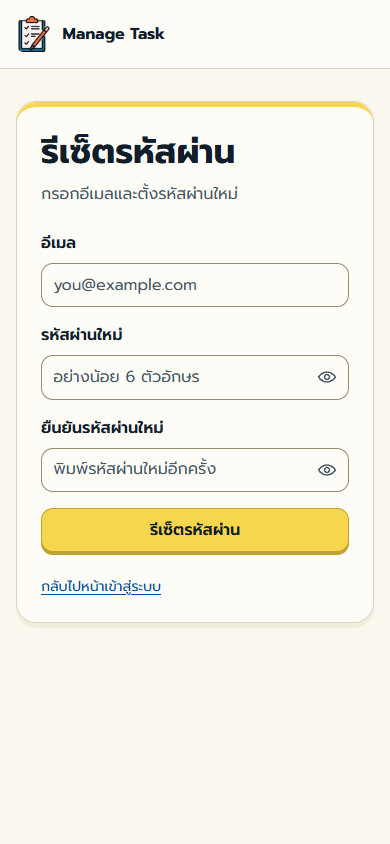

# 📋 ระบบจัดการงาน (Manage Task App)

แอปพลิเคชันสำหรับจัดการงานรายวันของคุณ สร้างขึ้นด้วย Next.js และ Supabase ช่วยให้คุณติดตามงาน จัดการตารางเวลา และเพิ่มประสิทธิภาพการทำงานด้วยหน้าจอที่ใช้งานง่ายและสะอาดตา

<div align="center">
  
</div>

## ✨ ฟีเจอร์หลัก

- **ระบบบัญชีผู้ใช้**: สมัครสมาชิก, เข้าสู่ระบบ และระบบกู้คืนรหัสผ่านที่ปลอดภัย
- **จัดการงาน (Task Management)**: เพิ่ม, ดู, แก้ไข, และลบงานได้อย่างง่ายดาย
- **แก้ไขโปรไฟล์**: ผู้ใช้สามารถอัปโหลดรูปโปรไฟล์ของตัวเองได้
- **รองรับทุกขนาดหน้าจอ (Responsive)**: ออกแบบด้วย Tailwind CSS เพื่อให้ใช้งานได้ดีทั้งบนคอมพิวเตอร์และมือถือ
- **ดีไซน์ทันสมัย**: มาพร้อมกับโทนสีครีม–เหลืองที่ดูสบายตา ตัวหนังสืออ่านง่าย และมีลูกเล่น Animation เล็กๆ น้อยๆ

## 🛠️ เครื่องมือที่ใช้ (Tech Stack)

- **Frontend**: [Next.js](https://nextjs.org/) (React Framework)
- **Styling**: [Tailwind CSS](https://tailwindcss.com/)
- **Backend & Database**: [Supabase](https://supabase.com/) (PostgreSQL & Storage)
- **Language**: TypeScript

## 📸 ภาพตัวอย่างหน้าจอ

ภาพหน้ารายการและหน้าแก้ไขงานใช้ข้อมูลตัวอย่าง

### 🖥️ หน้ารายการงาน (Dashboard)
<div align="center">
  
</div>

### 📝 หน้าสร้างงาน (Add Task)
<div align="center">
  
</div>

### 🔐 หน้าเข้าสู่ระบบและสมัครสมาชิก
<div align="center">
  
  
</div>

### 🔍 ภาพหน้าจออื่นๆ
<details>
<summary><b>หน้าแก้ไขงานและหน้ารีเซ็ตรหัสผ่าน</b></summary>
<br>
<div align="center">
  
  <br><br>
  
</div>
</details>

## 🚀 วิธีการติดตั้งและรันโปรเจกต์

### สิ่งที่ต้องมี
- Node.js (เวอร์ชัน 18 ขึ้นไป)
- npm หรือ yarn

### ขั้นตอนการติดตั้ง

1. **โคลนโปรเจกต์:**
   ```bash
   git clone https://github.com/your-username/next-manage-task-app.git
   cd next-manage-task-app
   ```

2. **ติดตั้ง Dependencies:**
   ```bash
   npm install
   ```

3. **ตั้งค่าตัวแปร Environment:**
   สร้างไฟล์ `.env.local` ในโฟลเดอร์หลักของโปรเจกต์ และใส่ค่า Supabase ของคุณลงไป:
   ```env
   NEXT_PUBLIC_SUPABASE_URL=your_supabase_project_url
   NEXT_PUBLIC_SUPABASE_ANON_KEY=your_supabase_anon_key
   ```

4. **รันเซิร์ฟเวอร์จำลอง (Development Server):**
   ```bash
   npm run dev
   ```
   เปิดเว็บเบราว์เซอร์ไปที่ [http://localhost:3000](http://localhost:3000) เพื่อดูผลลัพธ์

## 🤝 การมีส่วนร่วมพัฒนาระบบ

ยินดีต้อนรับทุกการมีส่วนร่วมครับ! ไม่ว่าจะเป็นการแจ้งปัญหา (Issues) หรือเสนอแนะฟีเจอร์ใหม่ๆ 


